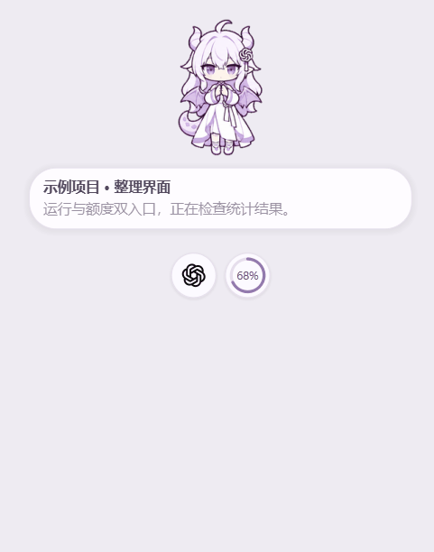
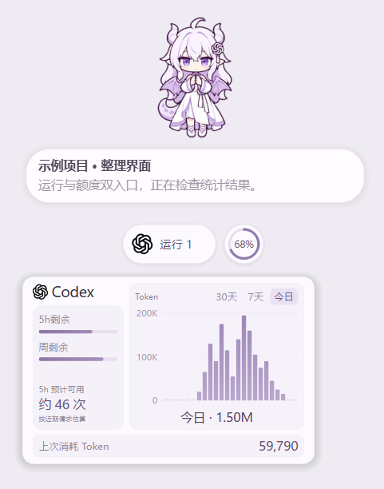
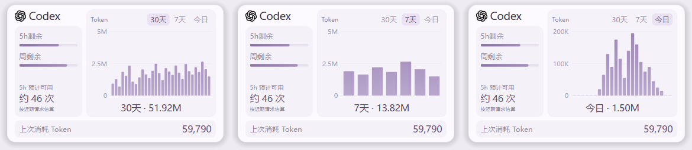

# Codex Pet Usage



*悬停展开与面板开关演示，使用示例数据。*

Windows 上的独立 Codex 桌宠伴侣，提供额度、Token 统计和原生对话进度摘要。界面使用 PySide6。

这是独立运行的非官方工具。它只读本机 Codex 账户与会话数据，不修改 Codex 安装文件，也不替换原版桌宠。

## 演示

以下图片由当前程序实际渲染，标题、摘要与用量均为示例数据。宠物外观取决于本机已安装的素材。



<details>
<summary>查看30天、7天和今日统计</summary>



</details>

## 功能

- **两个圆形入口**：运行状态、额度。悬停时只有对应入口展开，展开宽度一致。
- **用量面板**：悬停运行入口打开；面板贴近圆环，并避开宠物与对话摘要。
- **Token 图表**：30天显示30根日柱，7天显示7根日柱，今日显示24根小时柱；左侧显示消耗刻度，下方显示合计。
- **额度估算**：显示五小时与每周额度进度，以及按近期实际消耗估算的剩余请求次数。
- **上次消耗 Token**：按本机用量记录时间选择最近一次请求，展示其输入和输出合计。
- **原生对话摘要**：显示 Codex 中正在进行的对话标题和最新回复摘要，并把圆环下推；点击摘要打开 Codex 对应对话。
- **清晰图标与动画**：使用矢量软件图标、透明背景、圆角、阴影和可中途反向衔接的展开动画。
- **牵手拖动**：动作以10帧/秒播放；拖动时拉住靠近鼠标的一只手并保持稳定姿态，松手后恢复正常动作。不同动作之间有短暂的平滑过渡。
- **随 Codex 启动**：启用后，Codex 主窗口出现时自动打开桌宠，重复打开不会出现多只。

桌宠内独立聊天、输入框、回复窗口、附件和语音入口已移除。右键宠物不弹设置；悬停文字提示已关闭。面板中的 Codex 标题可打开宠物大小、选择宠物、退出三个菜单项。

## 环境

- Windows 10 / 11。
- Python 3.10 或更高版本；当前版本在 Python 3.10 上验证。
- 已安装并登录 Codex 桌面应用，且本机可使用其 `app-server`。
- 本机已经安装兼容的宠物素材。程序读取 `%CODEX_HOME%\pets`，未设置时使用 `%USERPROFILE%\.codex\pets`。仓库不包含可供运行的宠物精灵表。

依赖版本见 [requirements.txt](requirements.txt)。当前宠物读取器支持宽1536、高1872或2288的既有精灵表，每帧192×208。

## 安装与启动

下载仓库后，解压到独立目录，例如 `D:\Z-job\CodexPet`，在该目录中运行 PowerShell：

```powershell
py -3.10 -m venv .venv
.\.venv\Scripts\python.exe -m pip install -r requirements.txt
powershell -NoProfile -ExecutionPolicy Bypass -File .\start.ps1
```

以后可双击 `启动面板.vbs`。启动器优先使用项目的 `.venv`；也支持本机常见 Python 3.10 安装目录和 PATH 中的 `pythonw.exe`。推荐使用独立环境，避免登录时找不到用户级依赖。

若依赖已经安装，也可直接运行 `python pet_usage.py`。启动失败时查看同目录的 `startup-error.log`。如果同时出现两只宠物，可在 Codex 中隐藏原版悬浮宠物。

移动安装目录时，应在新位置重新创建 `.venv` 并安装依赖，保留 `settings.json`，再重新启用自动启动。

### 随 Codex 启动

双击 **`随Codex启动.vbs`** 启用。后台检查程序每秒检测一次 Codex 主窗口；已经打开 Codex 时会立即启动桌宠。

启用时添加当前用户的 Windows 登录启动项 `CodexPetUsageWatcher`，以后登录 Windows 后继续检测，无需管理员权限。手动退出桌宠后，只要 Codex 主窗口持续打开，就不会反复弹回；下次打开 Codex 主窗口时再启动。

双击 **`取消随Codex启动.vbs`** 可移除该启动项并停止后台检测。也可以使用 PowerShell：

```powershell
# 启用
powershell -NoProfile -ExecutionPolicy Bypass -File .\start.ps1 -FollowCodex
# 取消
powershell -NoProfile -ExecutionPolicy Bypass -File .\start.ps1 -DisableFollowCodex
```

## 数据与统计口径

- 账户额度与图表用量每分钟刷新，活动状态和最近请求用量每5秒读取。
- 30天、7天包含今日，使用账户每日统计；账户尚未返回今日记录时，用本机今日合计补充。
- 今日按**北京时间 UTC+8 当天00:00**开始分为24小时，不使用滚动24小时。请求按 `response_id` 去重。
- 账户每日统计与本机日志覆盖范围可能不同。没有记录的日期或小时保留零值位置，尚未读取的数据保持等待状态。
- 剩余次数是观察估算：需要至少3次请求、30秒观察时间和1个百分点的额度变化。样本不足显示“采样中”，模型、请求长度和其他设备使用都会影响结果。
- 仅从 Codex 读取已有活动；桌宠不创建独立对话、不发送消息或附件。

## 本地文件

| 文件或目录 | 内容 |
| --- | --- |
| `settings.json` | 宠物位置与偏好 |
| `work/autostart.log` | 自动启动异常信息 |
| `startup-error.log` | 启动异常信息 |

运行数据已加入 `.gitignore`，不随源码提交。程序不写入 Codex 数据库或已有会话日志。

## 源码

| 文件 | 用途 |
| --- | --- |
| `pet_usage.py` | 启动入口与错误日志 |
| `pet_desktop.py` | 桌宠、摘要、统计面板、动画与避让 |
| `pet_toolbar.py` | 运行、额度双圆环交互 |
| `codex_data.py` | 只读账户与会话数据读取 |
| `usage_series.py` | 按日期与小时整理固定柱数的数据 |
| `quota_estimate.py` | 根据观测消耗估算剩余请求次数 |
| `pet_autostart.py` | 当前用户的自动启动配置与 Codex 主窗口检测 |

## 验证

```powershell
python tests/verify_usage_series.py
python tests/verify_quota_estimate.py
python tests/verify_autostart.py
python tests/verify_usage_ui.py
python tests/verify_pet_motion.py
```

统计和自动启动逻辑使用示例数据验证；界面检查覆盖双圆环独立展开、指针保持、面板开关、固定30/7/24根柱、原生摘要跳转与下推、屏幕边缘避让及聊天模块缺失。检查不调用模型或读取个人会话日志。

界面详细说明见 [使用说明.md](使用说明.md)。账户与会话接口依赖本机 Codex 版本，接口变化时可能需要适配。

`codex-app.svg` 与备用 PNG 来自本机软件安装包中的 OpenAI 标识资源；宠物素材由用户自行安装。项目不包含 Codex 程序或登录凭据。
